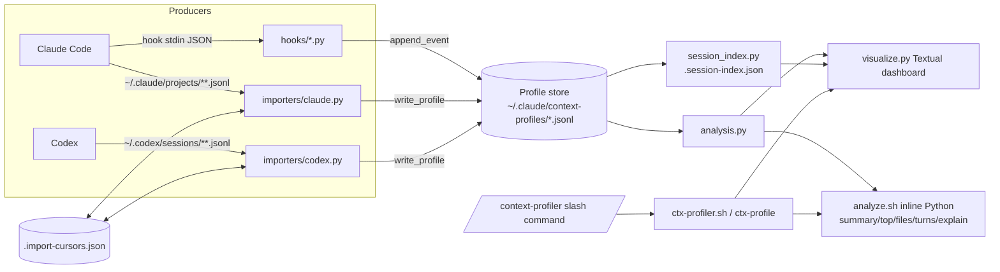

# context-profiler — Architecture

## Service Description

Context Profiler is a local, single-user developer tool that observes Claude Code
and Codex agent sessions and explains context-window growth: expensive turns,
large tool results, repeated file reads, compactions/resets, skills loaded, and
parent/child agent activity. It ships as a Python package plus shell CLI, a
Textual terminal dashboard, Claude Code hook scripts, and Claude/Codex plugin
manifests with a `/context-profiler` slash command.

Primary design constraint (`AGENTS.md` § Project Intent): profiling must stay out
of the observed model's context window. The dashboard refuses non-TTY stdout
(`ctx-profiler.sh` `watch`, `analyze.sh --watch`) and agent-facing commands
return compact text summaries.

## Runtime / Deployment Location

- Runs entirely on the operator's workstation as local processes; no server,
  network listener, container, or cloud deployment exists in the repo.
- Installed by `bash ./ctx-profiler.sh setup`, which writes to the user's home
  directory: Claude hook entries in `~/.claude/settings.json`, command shims in
  `~/.claude/commands/` and `~/.codex/commands/`, a Codex plugin copy under
  `~/.codex/plugins/context-profiler`, and `~/.local/bin/ctx-profile` plus the
  `ctx-profiler` alias (`ctx-profiler.sh` `install_*` functions).
- See `runtime-setup.md` and `infra.md` for setup and (absent) infrastructure.

## Stack

| Aspect | Value | Evidence |
|---|---|---|
| Language | Python 3 (uses `from __future__ import annotations`, PEP 604 unions), Bash | `context_profiler/*.py`, `*.sh` |
| UI framework | Textual (optional dependency, installed with `--install-textual`) | `visualize.py:42-45`, `ctx-profiler.sh ensure_textual` |
| Build/packaging | None (no `pyproject.toml`/`setup.py`); executed from the checkout via `sys.path` insertion | repo file list |
| Tests | stdlib `unittest` | `tests/`, `AGENTS.md` § Test |
| Persistence | JSONL files + small JSON cache/state files under `~/.claude/context-profiles/` | `context_profiler/config.py`, `storage.py` |
| Plugin targets | Claude Code plugin (`.claude-plugin/plugin.json`), Codex plugin (`.codex-plugin/plugin.json`), version 0.1.0 | manifests |

## Architecture Overview

The system is a local pipeline: **source adapters** (Claude hooks, Claude
transcript importer, Codex rollout importer) normalize native telemetry into a
shared JSONL **profile store**; read-side **analysis** derives stats, turns,
forensics, agent runs, and advice; two **presentation surfaces** (Textual TUI for
humans, compact CLI text for agents) render it. `context_profiler_core.py` is a
compatibility facade re-exporting the package API for hooks and shell scripts.

## Layer / Boundary Model

| Layer | Files | Responsibility | May depend on |
|---|---|---|---|
| Entry / shell | `ctx-profiler.sh`, `analyze.sh`, `codex-profiler.py`, `commands/context-profiler.md` | Command dispatch, setup/install side effects, TTY guard, agent-facing CLI output | facade |
| Hook adapters | `hooks/session-start.py`, `pre-tool-use.py`, `post-tool-use.py`, `pre-compact.py`, `session-end.py` | Convert Claude hook payloads to normalized events; swallow all errors | facade |
| Facade | `context_profiler_core.py` | Re-export stable API for scripts/hooks | package modules |
| Importers | `context_profiler/importers/{base,claude,codex}.py` | Parse native transcripts into normalized events; agent lifecycle detection | storage, config, formatting |
| Store | `context_profiler/storage.py`, `session_index.py` | Profile paths, append/rewrite with rotation, load, cleanup, import cursors, session index cache | config |
| Analysis | `context_profiler/analysis.py`, `formatting.py` | Pure derivation: stats, turns, forensics, agent runs, recommendations, ignore filtering, token estimate | config |
| Config | `context_profiler/config.py` | Paths, defaults, merge/load/save of `config.json`, enable flag, sources | stdlib only |
| Presentation | `visualize.py` | Textual app, tabs, keybindings, refresh loop | facade |

Source-neutrality rule (`AGENTS.md` § Preserve source neutrality): Claude/Codex
specifics belong only in importer/hook adapters; storage, analysis, and
visualization operate on normalized events keyed by a free-form `source`.

## Runtime / Request Flows

1. **Claude live capture (write path).** Claude Code invokes hook scripts
   asynchronously (`"async": True` in installed hook entry). `pre-tool-use.py`
   writes a start-epoch stamp file under `/tmp/ctx-profiler-start/<session>/`;
   `post-tool-use.py` consumes the newest stamp to compute duration, calls
   `normalize_claude_tool_event`, and `append_event(..., "claude")`.
   `session-start`, `pre-compact`, and `session-end` (Stop) append
   `session_start`, `compaction`, `session_end` events. Every hook checks
   `is_enabled()` and silently swallows exceptions so the observed session is
   never disrupted.
2. **Transcript import (write path).** On each dashboard refresh and each
   `analyze.sh` CLI call (unless `--no-claude-import`/`--no-codex-import`),
   `import_latest_claude_profiles` / `import_latest_codex_profiles` select the N
   most recently modified transcripts (`claude_import_limit` /
   `codex_import_limit`, default 25), skip unchanged ones via
   `.import-cursors.json` signatures, and rewrite the whole logical profile with
   `write_profile` (temp file + atomic `replace`, chunked into rotated parts).
   The Claude importer merges Agent tool events into hook-written profiles by
   `raw_tool_use_id` or description; the Codex importer rebuilds a full profile
   from the rollout (`session_meta`, function calls, `spawn_agent`/`wait_agent`
   lifecycle, SKILL.md reads).
3. **Auto-cleanup (delete path).** `run_auto_cleanup` runs at most once per
   `auto_cleanup_interval_hours` (state in `.cleanup-state.json`) and deletes
   logical profiles whose newest part is older than `cleanup_retention_days`.
   Raw Codex transcripts are only deleted by explicit
   `clean --include-codex-transcripts`.
4. **Dashboard read path.** `visualize.py` runs `set_interval(refresh_interval_seconds)`;
   each refresh runs cleanup + imports, refreshes the session index, loads events
   for the selected source/session, and renders only the active tab.
5. **Agent CLI read path.** `ctx-profile latest|summary|session|top|files|turns|explain`
   → `analyze.sh` → inline Python using facade functions → compact text to stdout.

### Flow ownership map

| Flow | Trigger | Writer / owner | State touched | Failure behavior | Verification |
|---|---|---|---|---|---|
| Hook capture | Claude hook event | `storage.append_event` | `<session>.jsonl` (+ parts) | errors swallowed, event dropped | `tests/test_storage.py` rotation tests; hooks themselves untested |
| Transcript import | dashboard refresh / CLI call | `storage.write_profile` via importers | profiles, `.import-cursors.json` | unreadable transcript → `None`, skipped | `tests/test_claude_importer.py`, `tests/test_codex_importer.py`, `test_storage.py` cursor tests |
| Auto/explicit cleanup | refresh / `clean` | `storage.cleanup_old_profiles`, `cleanup_old_codex_transcripts` | profile files, `.cleanup-state.json`, optionally `~/.codex/sessions` | per-path error recorded in result | `test_storage.py` cleanup tests |
| Session index | dashboard refresh | `session_index.refresh_session_index` | `.session-index.json` | rebuildable cache | `tests/test_session_index.py` |
| Enable/disable/config | `ctx-profile enable|disable|setup` | `config.save_config` | `config.json` | merges defaults | evidence absent (no direct test) |
| Setup install | `ctx-profile setup` | `ctx-profiler.sh` install functions | `~/.claude/settings.json`, command shims, `~/.local/bin`, `~/.codex/plugins` | `set -euo pipefail` | evidence absent (no test) |

### Read-model / multi-client boundaries

- **Source of truth:** profile JSONL parts under `PROFILE_DIR`; for Codex and
  Claude-Agent events the upstream raw transcripts are the ultimate source and
  profiles are re-derivable projections.
- **Projections/caches:** `.session-index.json` (per-session summary, invalidated
  by part signatures), `.import-cursors.json` (versioned, `IMPORT_CURSOR_VERSION = 2`).
  Both are documented as safe to delete (README § How Advice Works).
- **Clients:** Textual TUI and `analyze.sh` CLI both consume `analysis.py`
  via the facade; no JSON/MCP machine contract yet (README § Consumption Model
  lists `--json` and MCP tools as future targets).
- **Permission/tenant boundary:** not applicable — single local user; access is
  governed by home-directory filesystem permissions.

## Public Surface / API Contracts

| Surface | Actor | Contract | Auth |
|---|---|---|---|
| `ctx-profile` / `ctx-profiler` CLI (`ctx-profiler.sh`) | operator, agents via slash command | subcommands: `setup [--install-textual]`, `watch [source] [--source] [--session] [--all-sessions]`, `status`, `enable`, `disable`, `latest`, `summary`, `session <id>`, `top [N]`, `files [N] [--include-ignored]`, `turns`, `explain`, `clean [--days N] [--dry-run] [--include-codex-transcripts]`, `codex-import [--limit N]`, `doctor`; exit 2 on unknown command | local user only |
| `/context-profiler` slash command (`commands/context-profiler.md`) | Claude Code / Codex agent | runs `ctx-profile ${ARGUMENTS:-status}`; `watch` must not be streamed through transcript | inherits agent's local shell permissions |
| Claude hook scripts | Claude Code | stdin JSON with `session_id`, `tool_name`, `tool_input`, `tool_response`, `transcript_path`, `cwd`; no stdout contract; always exit 0 | local |
| `codex-profiler.py` | operator/scripts | `--watch`, `--once`, `--latest`, `--session-file`, `--limit`, `--interval`; exit 1 when no Codex transcripts | local |
| `visualize.py` | operator via `watch` | `--session`, `--all-sessions`, `--source` | local |
| Python package API | future importers / scripts | `ProfileImporter` protocol (`importers/base.py`), `storage.write_profile(session_id, events, source)`, `append_event`; README § Architecture "To add another harness" | n/a |

Public API auth: not applicable — no internet-reachable route, handler, webhook,
or listener exists in the repo (no socket/HTTP code found in `*.py`/`*.sh`).

### Normalized event contract

Event `type` values: `session_start`, `turn_start`, `context_snapshot`,
`tool_call`, `compaction`, `session_end` (README § Architecture). Common fields:
`ts`, `source`, `session_id`; tool events carry `tool`, byte counts,
`est_tokens` (approximate: bytes/4 heuristic in `formatting.estimate_tokens`),
optional `duration_ms`, and `meta` (e.g. `raw_tool_use_id`, `parent_session_id`,
`child_session_id(s)`, `subagent_transcript_path`, agent status). The schema is
implicit in code; there is no versioned schema file — see Risks.

## Data Models and Schemas

| Store | Format | Owner | Lifecycle |
|---|---|---|---|
| `~/.claude/context-profiles/<session>.jsonl`, `codex-<session>.jsonl`, `*.part-NNNN.jsonl` | JSONL normalized events; rotation at `profile_max_part_bytes` (10 MB default) | `storage.py` | auto-cleaned after 5 days |
| `config.json` | JSON, defaults in `config.DEFAULT_CONFIG`; user values merged, default ignore patterns always re-added | `config.py` | persistent |
| `.import-cursors.json` | JSON transcript signatures (size/mtime), versioned | `storage.py` | rebuildable |
| `.session-index.json` | JSON per-session summaries | `session_index.py` | rebuildable |
| `.cleanup-state.json` | JSON last cleanup ts | `storage.run_auto_cleanup` | rebuildable |
| `/tmp/ctx-profiler-start/<session>/<tool>-<epoch_ms>` | plain epoch stamp | `hooks/pre-tool-use.py` | consumed by post hook; >60s pruned |

No database, migrations, or remote storage.

## Dependency Direction And Coupling

- Direction: entry scripts/hooks/TUI → `context_profiler_core` facade →
  `importers` → `storage` → `config`; `analysis`/`formatting` → `config`.
  `config.py` depends only on stdlib. No cycles observed from import statements.
- External runtime deps: Python stdlib; `textual` only for `visualize.py`;
  `git` binary via `formatting.git_branch_for`; Bash.
- Coupling to upstream harness formats: importers depend on undocumented,
  vendor-controlled transcript formats (Claude `~/.claude/projects/**.jsonl`
  rows with `sessionId`, Agent tool use, `subagents/` sidechains; Codex rollout
  `session_meta`, `function_call`, `spawn_agent`, `wait_agent`). Format changes
  upstream silently degrade import (errors are caught and rows skipped).
- Coupling to profile directory: `PROFILE_DIR` is computed at import time from
  `Path.home()`; tests monkeypatch module globals (`storage.PROFILE_DIR`,
  `session_index.PROFILE_DIR`).
- `analyze.sh` embeds a large inline Python program (heredoc, ~400 lines) that
  duplicates some formatting helpers (`fmt_bytes`, `fmt_tokens`) from
  `formatting.py`.

## Module / Package Inventory

Single-repo, single runtime unit (no nested build markers, no nested
`CLAUDE.md`/`AGENTS.md`; only root `AGENTS.md`). Semantic boundaries with
distinct entrypoints, writers, or failure rules are documented in focused module
docs:

- `hooks/` — Claude hook adapters (distinct entrypoint, live writer, fail-silent rule).
- `context_profiler/importers/` — transcript import adapters (agent lifecycle
  semantics, cursor state).
- `context_profiler/storage.py` + `session_index.py` + `config.py` — profile store
  and config (sole writer of durable state, rotation, cleanup).
- `visualize.py` + `analyze.sh` + `ctx-profiler.sh` + `analysis.py` — operator and
  agent surfaces (CLI dispatch, setup side effects, TUI, derived analysis).

## Module Detail Coverage

| Module / Boundary | Detail |
|---|---|
| Claude hook adapters (`hooks/`) | `docs/prinevo-docs/modules/claude-hooks.md` |
| Transcript importers (`context_profiler/importers/`) | `docs/prinevo-docs/modules/importers.md` |
| Profile store and config (`storage.py`, `session_index.py`, `config.py`) | `docs/prinevo-docs/modules/profile-store.md` |
| CLI, setup, analysis, and dashboard (`ctx-profiler.sh`, `analyze.sh`, `analysis.py`, `visualize.py`) | `docs/prinevo-docs/modules/cli-and-dashboard.md` |

## Domain Language

Source-backed vocabulary is maintained in `domain-language.md`. Core terms:
profile, source, session, turn, tool call, spike, compaction, agent run,
parent/child session, advice/recommendation, ignored path.

## Architecture Risks / Hotspots

| Risk | Evidence | Impact |
|---|---|---|
| Upstream transcript format drift | importers parse vendor JSONL shapes with broad `except` | silent loss of agent/skill/file attribution |
| Implicit event schema | no schema/version field on events; contract lives in importers + analysis | adding a harness can drift field names |
| Silent hook failures | every hook wraps body in `except Exception: pass` | capture gaps are invisible; no diagnostics log |
| `/tmp` stamp files keyed by session/tool | `pre-tool-use.py`, `post-tool-use.py` | concurrent same-tool calls pair to the newest stamp; durations approximate |
| Full-profile rewrite on import | `write_profile` rewrites all parts when content changes | O(profile size) work per changed transcript per refresh |
| Large inline Python in `analyze.sh` | heredoc program | harder to test; duplicates helpers; no unit tests for CLI output |
| `visualize.py` size (1311 lines) | single Textual app class | UI hotspot for change conflicts |
| Setup mutates `~/.claude/settings.json` | `install_claude_hooks` rewrites file, removes other `context-profiler/hooks/` entries | malformed existing JSON is replaced with `{}`-based content (data loss risk) |
| Test suite requires Textual | `tests/test_visualize_sessions.py` imports `visualize` | 1 of 17 tests errors without `textual` |
| Token counts are estimates | `estimate_tokens` bytes/4 | advice is relative, not billing-accurate (documented) |

Refactor candidates: move `analyze.sh` Python into a `context_profiler/cli.py`
module with tests; add an explicit event `schema_version`; make the TUI import
of `textual` lazy so non-UI helpers are testable without it; add an opt-in hook
error log outside the model context.

## Current-State HLD / LLD

- HLD: one local process family; boundaries = adapters → store → analysis →
  presentation; external interactions limited to reading Claude/Codex transcript
  directories and writing Claude/Codex user config. Failure posture: never break
  the observed session; caches rebuildable.
- LLD: state writers are `storage.append_event`, `storage.write_profile`,
  `storage` cleanup functions, `config.save_config`, `session_index._write_index`,
  and setup shell functions. Invariants: one logical session = base file + ordered
  parts; profiler/transcript paths hidden from advice by default; raw transcripts
  not deleted without explicit flag; dashboard requires TTY.

## Architecture Completeness

| Dimension | Status |
|---|---|
| Scope | captured (Service Description) |
| Entry | captured (Public Surface) |
| Contract | captured; event schema implicit (risk) |
| State | captured (Data Models) |
| Writer | captured (Flow ownership map, LLD) |
| Flow | captured (Runtime / Request Flows) |
| Verification | `python3 -m unittest discover -s tests -v`; hooks, CLI output, setup untested |
| Operation | local only; see `runtime-setup.md` |
| Evolution | add harness via `ProfileImporter` + `write_profile` + `sources` config |

## Scanner Evidence Gate

No blocking ambiguity. Repo is small (~6.3k lines across Python/Bash/Markdown);
all source modules, hooks, scripts, manifests, and tests were read or
signature-scanned. The factory guideline files referenced by the scanner
contract (`docs/harness/guidelines/architecture-docs.md`,
`runtime-setup-doc.md`) are not present in this factory checkout; structure was
taken from the scanner contract and the repo-doc validator required headings.

## Confidence

High for structure, flows, and storage (direct source reading). Medium for
importer edge semantics (signature-level scan of `importers/codex.py` /
`claude.py` plus README and tests). Low/absent for runtime behavior under
real Claude/Codex sessions (no live run performed by scanner).

## Agent Work Log

- Inputs checked: `AGENTS.md`, `README.md`, plugin manifests, `commands/context-profiler.md`,
  `ctx-profiler.sh`, `analyze.sh`, `codex-profiler.py`, `context_profiler_core.py`,
  `context_profiler/*.py`, `context_profiler/importers/*.py`, `hooks/*.py`,
  `visualize.py` (structure), `tests/*.py`; factory `factory.json` (no cloud/observability integrations).
- Verification run: unit tests under an isolated temporary `HOME` with bytecode
  writes disabled → 17 tests, 16 pass, 1 error (`ModuleNotFoundError: textual`
  in `tests/test_visualize_sessions.py`).
- Decisions: four semantic module docs (hooks, importers, store, CLI/dashboard);
  domain-language.md written because source-backed terms exist.
- Gaps: no CI, no IaC, no packaging metadata, hooks/CLI/setup untested; live
  session behavior not observed.
- Next action: `/prinevo-bring-up context-profiler` if local runtime proof is needed.

## References

- `README.md`, `AGENTS.md`, `runtime-setup.md`, `infra.md`, `domain-language.md`, `modules/*.md`
