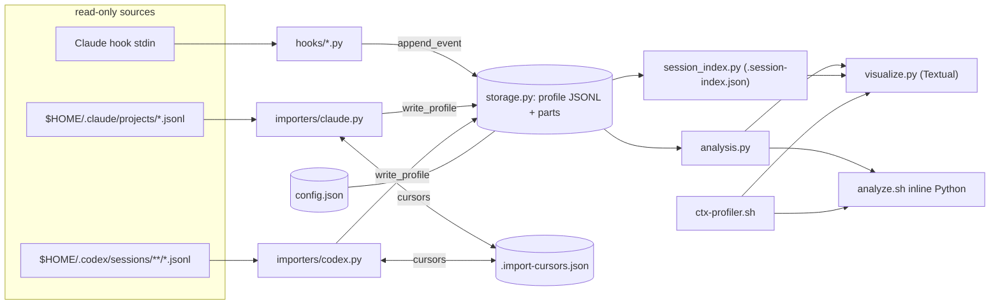

# context-profiler Architecture

## Service Summary

| Field | Value | Evidence |
|---|---|---|
| Description | Local, single-user observability tool for coding-agent sessions (Claude Code and Codex). It records/imports session telemetry into a shared JSONL profile store and renders a Textual terminal dashboard plus compact CLI summaries of context growth, spikes, tool/file/agent/skill usage, turns, compactions, and advice. | `README.md`, `AGENTS.md`, `context_profiler/__init__.py` |
| Classification | Local developer tool / harness plugin (CLI + TUI + hook scripts). Not a deployable network service; no server, no ports. | `ctx-profiler.sh`, `visualize.py`, `.claude-plugin/plugin.json`, `.codex-plugin/plugin.json` |
| Users / callers | Human operator in an interactive terminal (`ctx-profile watch`); agents via compact commands (`explain`, `files`, `turns`, `latest`) and the `/context-profiler` slash command; Claude Code hook runtime (stdin JSON). | `README.md § Consumption Model`, `commands/context-profiler.md`, `hooks/*.py` |
| Primary capabilities | Claude hook capture; Claude and Codex transcript import; JSONL profile persistence with rotation; session index cache; analysis (stats, turns, forensics, agent runs, recommendations); TUI and CLI presentation; retention cleanup; idempotent host setup. | `context_profiler/*`, `analyze.sh`, `visualize.py` |
| State | Host-local files under `$HOME/.claude/context-profiles/` (profiles, config, caches); read-only inputs from `$HOME/.claude/projects/` and `$HOME/.codex/sessions/`. No database, queue, or remote store. | `context_profiler/config.py`, `context_profiler/storage.py` |
| Runtime | Python 3 stdlib + optional `textual` for the TUI; Bash wrappers. Portable setup inputs live in [runtime-setup.md](runtime-setup.md). | `ctx-profiler.sh`, `visualize.py` |
| Confidence | High for module boundaries, flows, and storage; medium for hook concurrency risk (code-read, not reproduced). | this scan |

## What This Repo Owns

- The normalized profile event schema (`session_start`, `turn_start`, `context_snapshot`, `tool_call`, `compaction`, `session_end`) and its JSONL persistence.
- Source adapters translating Claude hook payloads / Claude transcripts / Codex rollout transcripts into that schema.
- Derived analytics and heuristic advice; the TUI and CLI consumption surfaces.
- Host setup that installs Claude hooks into `$HOME/.claude/settings.json`, slash-command shims, a Codex plugin copy, and `$HOME/.local/bin/ctx-profile` shims.

It does not own the Claude or Codex transcript formats (consumed, read-only) nor any remote system.

## Main Capabilities

1. **Live capture (Claude)** — five hook scripts append events as Claude Code runs.
2. **Transcript import (Claude, Codex)** — incremental, signature-cursored import on each dashboard/CLI refresh.
3. **Profile store** — per-session JSONL with size-based part rotation, atomic rewrite, retention cleanup.
4. **Analysis** — `compute_stats`, `build_turns`, `build_forensics`, `build_agent_runs`, `build_recommendations`.
5. **Presentation** — Textual dashboard (`visualize.py`) and text CLI (`analyze.sh` inline Python).

## Module / Package Inventory

Module assessment: **single runtime (one local tool) with important internal semantic boundaries.** No nested package manifests, no nested `CLAUDE.md`/`AGENTS.md` (only root `AGENTS.md`). Root context alone would flatten three distinct ownership boundaries (write-side ingestion adapters, the store/writer, and read-side clients), so focused module docs are provided.

| Path | Purpose | Entrypoints | Ownership hint | Detail |
|---|---|---|---|---|
| `hooks/`, `context_profiler/importers/`, `codex-profiler.py` | Source adapters → normalized events | Claude hook stdin; refresh-time import; `codex-import` | Write-side ingestion | [modules/profile-ingestion.md](modules/profile-ingestion.md) |
| `context_profiler/storage.py`, `context_profiler/session_index.py`, `context_profiler/config.py` | Profile store, cursors, session index, config, cleanup | library calls only | Canonical state writer | [modules/profile-store.md](modules/profile-store.md) |
| `context_profiler/analysis.py`, `context_profiler/formatting.py`, `visualize.py`, `analyze.sh`, `ctx-profiler.sh`, `commands/` | Derived read models and human/agent clients | `ctx-profile <cmd>`, `/context-profiler`, `visualize.py` | Read-side / multi-client | [modules/dashboard-and-cli.md](modules/dashboard-and-cli.md) |
| `context_profiler_core.py` | Compatibility facade re-exporting package API for hooks and shell scripts | import only | Facade (no logic) | root context is enough |
| `.claude-plugin/`, `.codex-plugin/` | Harness plugin manifests (v0.1.0) | plugin loaders | Packaging metadata | root context is enough |
| `tests/` | `unittest` suite (17 tests) | `python3 -m unittest discover -s tests` | Verification | root context is enough |

## Architecture Overview

Architectural style: **ports-and-adapters pipeline over a file-backed event log.** Source-specific adapters (hooks, importers) normalize native telemetry into one event schema; a single storage module owns profile files; analysis is a pure function layer over event lists; two clients (TUI, CLI) render the same analysis. Source neutrality is a stated design rule (`AGENTS.md § Preserve source neutrality`): Claude and Codex are *sources*, and a new harness is added by writing an importer and adding its name to `sources` config (`README.md § Architecture`, `context_profiler/importers/base.py::ProfileImporter`).

Primary design constraint (`AGENTS.md`): the profiler must stay out of the observed model's context window — the TUI refuses non-TTY output, and agent surfaces are compact summaries.

## Layer / Boundary Model

| Layer | Code | May depend on | Must not |
|---|---|---|---|
| Entry / clients | `ctx-profiler.sh`, `analyze.sh`, `visualize.py`, `hooks/*.py`, `codex-profiler.py` | `context_profiler_core` facade or `context_profiler.*` | Write profile files directly (all go through `storage`) |
| Facade | `context_profiler_core.py` | all package modules | contain logic |
| Adapters | `context_profiler/importers/{claude,codex}.py` | `config`, `formatting`, `storage` | depend on `analysis` or Textual |
| Domain/analysis | `context_profiler/analysis.py`, `session_index.py` | `config`, `formatting`, `storage` (read) | depend on importers or Textual |
| Persistence/config | `context_profiler/storage.py`, `config.py` | stdlib | depend on any higher layer |
| Presentation helpers | `context_profiler/formatting.py` | stdlib (`subprocess` for git branch) | — |

Textual is confined to `visualize.py` (`AGENTS.md § Code Style 3`). Verified by imports: no module under `context_profiler/` imports `textual`.

## Component Diagram



## Entry Points

| Entry | Trigger | File |
|---|---|---|
| `ctx-profile <subcommand>` (alias `ctx-profiler`) | operator/agent shell | `ctx-profiler.sh` → `analyze.sh` |
| `ctx-profile watch` | interactive TTY | `analyze.sh --watch` → `visualize.py` |
| `/context-profiler [args]` | Claude/Codex slash command | `commands/context-profiler.md` (rendered with `__CTX_PROFILER_SOURCE__`) |
| Claude hooks `SessionStart`, `PreToolUse`, `PostToolUse`, `PreCompact`, `Stop` | Claude Code runtime, async | `hooks/session-start.py`, `pre-tool-use.py`, `post-tool-use.py`, `pre-compact.py`, `session-end.py` |
| `codex-profiler.py [--watch|--once|--latest|--session-file]` | shell | `codex-profiler.py` |
| Python package API | import | `context_profiler_core.py` `__all__` |

## Internal Structure

See module docs. Key symbols: `storage.append_event`, `storage.write_profile`, `storage.load_events`, `storage.cleanup_old_profiles`, `storage.run_auto_cleanup`, `storage.transcript_import_current` / `mark_transcript_imported`, `session_index.refresh_session_index`, `analysis.compute_stats`, `analysis.build_turns`, `analysis.build_recommendations`, `importers.claude.normalize_claude_tool_event`, `importers.claude.import_claude_transcript`, `importers.codex.import_codex_transcript`.

## Runtime / Request Flows

**F1 — Claude live tool capture**
```text
Claude PostToolUse (stdin JSON) -> hooks/post-tool-use.py -> config.is_enabled
-> duration from /tmp/ctx-profiler-start/<session>/<tool>-<ms> (written by pre-tool-use.py)
-> importers.claude.normalize_claude_tool_event -> storage.append_event
-> $HOME/.claude/context-profiles/<session>.jsonl (or .part-NNNN) -> verification: tests/test_claude_importer.py
```
Hooks swallow all exceptions (`except Exception: pass`) so the observed session is never disrupted.

**F2 — Refresh-time transcript import (TUI and CLI)**
```text
visualize._refresh / analyze.sh startup -> storage.run_auto_cleanup (throttled)
-> import_latest_{claude,codex}_profiles(limit from config)
-> transcript_import_current? skip : import_*_transcript -> write_profile (atomic tmp+replace)
-> mark_transcript_imported (.import-cursors.json, signature=size+mtime_ns, cursor_version=2)
-> verification: tests/test_codex_importer.py, tests/test_claude_importer.py, tests/test_storage.py
```

**F3 — Dashboard render (read-only)**
```text
ctx-profile watch [source] (TTY required) -> visualize.ContextProfilerApp
-> get_latest_session / pinned session -> refresh_session_index -> load_events
-> analysis.compute_stats/build_turns/build_forensics/build_agent_runs/build_recommendations
-> Textual tables (active tab only) -> verification: tests/test_visualize_sessions.py (needs textual)
```

**F4 — Agent/CLI summary** — `ctx-profile explain|files|turns|latest|summary|top --session <id>` → `analyze.sh` inline Python → same analysis functions → plain text stdout.

**F5 — Cleanup** — `ctx-profile clean [--days N] [--dry-run] [--include-codex-transcripts]` → `cleanup_old_profiles` deletes whole logical profiles (all parts) older than retention; raw Codex transcripts only with explicit flag (`cleanup_old_codex_transcripts`).

**F6 — Setup (host mutation)** — `ctx-profile setup [--install-textual]` → `ensure_config`, optional `pip install --user textual`, rewrite `$HOME/.claude/settings.json` hook entries (dedupes prior `context-profiler/hooks/` commands), write command shims to `$HOME/.claude/commands/` and `$HOME/.codex/commands/`, copy Codex plugin to `$HOME/.codex/plugins/context-profiler`, write `$HOME/.local/bin/ctx-profile{,r}`.

## Read / Write Boundary

| State | Source of truth | Writer interface | Readers | Rebuild / staleness |
|---|---|---|---|---|
| Profile events | `<profile-dir>/<session>.jsonl` + `.part-NNNN.jsonl`; Codex stem prefixed `codex-` | `storage.append_event` (hooks), `storage.write_profile` (importers, full rewrite) | `storage.load_events` → analysis | Codex profiles are fully re-derivable from transcripts; Claude hook-only events are not re-derivable (transcript import only recreates Agent events) |
| Import cursors | `<profile-dir>/.import-cursors.json` | `mark_transcript_imported` (atomic) | `transcript_import_current` | Rebuildable cache; delete is safe (`README.md`) |
| Session index | `<profile-dir>/.session-index.json` | `session_index._write_index` (atomic) | TUI Sessions tab | Invalidated per profile part signature and spike threshold |
| Config | `<profile-dir>/config.json` | `config.save_config` / `ensure_config` (merges defaults, re-adds default ignore patterns) | every module via `load_config` | Missing/invalid JSON → defaults |
| Cleanup state | `<profile-dir>/.cleanup-state.json` | `run_auto_cleanup` | `run_auto_cleanup` | Throttle only |
| Tool start stamps | `/tmp/ctx-profiler-start/<session>/` | `hooks/pre-tool-use.py` | `hooks/post-tool-use.py` (consumes) | Files >60s pruned |

Forbidden shortcuts: clients writing profile files directly; analysis mutating state; deleting raw transcripts without explicit flag (`AGENTS.md § Context Safety Rules 3`). Permission/tenant boundary: single OS user; no auth. Failure behavior: malformed JSONL lines skipped; unreadable files return defaults/None; hooks fail silently.

## Multi-Client / Adapter Boundary

Shared read-model owner: `context_profiler/analysis.py` (+ `session_index.py` for session rows). Clients: Textual TUI (`visualize.py`), text CLI (`analyze.sh` inline Python), slash-command shim (delegates to CLI). Write adapters: Claude hooks, Claude importer, Codex importer, `codex-profiler.py`. Risk: `analyze.sh` re-implements formatting helpers (`fmt_bytes`, `fmt_tokens`) and some aggregation inline instead of using `formatting.py` — see hotspots.

## Dependency Direction And Coupling

- Direction is clean: clients → facade → analysis/importers → storage/config. No upward imports observed.
- `config.py` binds `PROFILE_DIR`, `CODEX_SESSIONS_DIR`, `CLAUDE_PROJECTS_DIR` at import time from `Path.home()`; importers honor `codex_sessions_dir` / `claude_projects_dir` config overrides, but the profile directory is not configurable (tests patch module globals).
- Hooks import via `sys.path.insert` of the repo root and the `context_profiler_core` facade — the facade is a compatibility contract for installed hook commands.
- `storage._rotation_limit_bytes` calls `load_config()` (file read) on every append — coupling of hot write path to config IO.
- Codex profiles live under `$HOME/.claude/` — storage location is Claude-named although source-neutral.

## Runtime Dependencies

Python 3 stdlib; `textual` (optional, TUI only, undeclared in any manifest — installed by `setup --install-textual`); `git` CLI (branch lookup, 2s timeout); Bash. No network dependencies.

## API Contracts

| Contract | Direction | Actor | Shape | Auth | Evidence |
|---|---|---|---|---|---|
| `ctx-profile` CLI subcommands | exposes | operator, agents | `setup, watch, status, enable, disable, latest, summary, session, top, files, turns, explain, clean, codex-import, doctor, help`; text output; exit 2 on usage error | local user only | `ctx-profiler.sh` usage/case |
| `/context-profiler` slash command | exposes | Claude/Codex | `$ARGUMENTS` forwarded to `ctx-profile` (default `status`) | local | `commands/context-profiler.md` |
| Claude hook stdin payload | consumes | Claude Code | JSON with `session_id`, `tool_name`, `tool_input`, `tool_response`/`tool_result`, `transcript_path`, `cwd` | local process | `hooks/*.py`, `normalize_claude_tool_event` |
| Claude transcript JSONL | consumes | file | rows with `sessionId`, `timestamp`, `message`, Agent tool_use/tool_result; sidechain `subagents/` transcripts | read-only | `importers/claude.py` |
| Codex rollout JSONL | consumes | file | `session_meta`, `event_msg` (`task_started`, `token_count`), `response_item` (`function_call`, `custom_tool_call`, outputs); `spawn_agent`/`wait_agent` | read-only | `importers/codex.py` |
| Normalized profile event JSONL | exposes (code-defined) | analysis, future harness importers | event `type` + `ts`, `source`, `session_id`, type-specific fields, `meta` | none | `README.md § Architecture` step 2, `storage.append_event` |
| `ProfileImporter` protocol | exposes | new harness adapters | `source: str`, `import_latest(limit) -> list[Path]` | n/a | `importers/base.py` |
| Python facade `context_profiler_core.__all__` | exposes | hooks, shell, external scripts | function exports | n/a | `context_profiler_core.py` |
| Future JSON / MCP agent contract | planned | agents | `--json` variants, `get_context_status` etc. | — | `README.md § Consumption Model` (not implemented) |

No internet-reachable surface exists; `Public API Auth Gap` is not applicable (all surfaces are local-user process/file boundaries).

## Data Models And Schemas

### Domain / Application Models

Plain dicts; no dataclasses. Turn record (`analysis._new_turn` / `build_turns`): index, boundary (`exact|estimated|estimated-gap`), timestamps, tokens, tool_calls, tools, files/top_files, agents/agent_statuses/agent_types, compactions, status (`classify_turn`: compaction, spike, agent-running, agent-heavy, file-heavy, tool-heavy, normal). Agent run (`build_agent_runs`), recommendation (`severity, title, detail, action`), stats (`compute_stats`, exactness `exact|snapshot-based|estimated-byte-derived`).

### Persistence Schemas

Event JSONL (code-defined): `session_start{cwd, git_branch, meta}`, `turn_start{turn_id, model_context_window}`, `context_snapshot{current_tokens, cumulative_total_tokens, est_tokens, model_context_window, input/cached/output/reasoning tokens}`, `tool_call{tool, input_bytes, output_bytes, est_tokens, cumulative_transcript_bytes, duration_ms?, meta{file_path|command|subagent_type|status|parent_session_id|child_session_id|skill_name|url|pattern...}}`, `compaction{compaction_index, transcript_bytes_before, est_tokens_before}`, `session_end{totals}`. Cursor file: `{source: {transcript_path: {cursor_version, signature{size,mtime_ns}, profile, status, imported_at}}}`. Session index: `{version:1, sessions:{path: summary}, updated_at}`. Config keys: see [runtime-setup.md](runtime-setup.md#configuration-and-credentials).

### API / DTO Schemas

CLI text output only; no JSON output yet (planned).

### Event Schemas

Same as persistence event JSONL; no message bus.

### Migrations / Schema Evolution

No migrations. `IMPORT_CURSOR_VERSION = 2` forces re-import when cursor semantics change. Event schema has no version field — evidence absent for event-schema versioning.

## Events / Queues / Background Work

No queues. Background work is in-process: TUI refresh timer (`refresh_interval_seconds`, default 2) runs cleanup + imports + index refresh; `codex-profiler.py --watch` polling loop; Claude hooks registered `async: true`.

## Data / Storage Ownership

All state host-local under `<profile-dir>` = `$HOME/.claude/context-profiles/` (owner: `storage.py`). Raw transcripts are owned by Claude Code / Codex and read-only here, except opt-in Codex transcript deletion.

## Architecture Risks / Hotspots

| Risk | Evidence | Impact | Confidence |
|---|---|---|---|
| Lost-update race between Claude hook appends and Claude transcript import rewriting the same profile | `import_claude_transcript` loads events, merges, then `write_profile` replaces all parts; `append_event` from `post-tool-use.py` can land in between | Occasional dropped live tool events in Claude profiles | medium (code-read, not reproduced) |
| `visualize.py` is a 1311-line Textual module mixing view, state, and aggregation | `visualize.py` | High change cost; only partially testable without TTY | high |
| CLI logic embedded as ~400 lines of inline Python heredoc in `analyze.sh`, duplicating formatting helpers | `analyze.sh` (`fmt_bytes`, `fmt_tokens`, `load_jsonl`) | Untested CLI path; drift from `formatting.py` | high |
| Token accounting is heuristic (bytes/4 unless `Original token count:` or Codex `token_count`) | `formatting.estimate_tokens`, `compute_stats` exactness | Advice is directional only (documented) | high |
| Pre-tool-use stamp directory uses raw `session_id` in `/tmp` path (storage sanitizes, hook does not) | `hooks/pre-tool-use.py`, `post-tool-use.py` | Low; local user input only | medium |
| `analyze.sh` interpolates `$PLUGIN_DIR` into `python3 -c` source strings | `analyze.sh --enable/--disable/--status` | Breaks if install path contains a quote | medium |
| Profile dir not configurable; config read per append | `config.py`, `storage._rotation_limit_bytes` | Portability/perf | medium |
| `textual` undeclared; no packaging manifest; no CI | repo root | Setup drift; tests need manual run | high |

## Refactor Candidates

Candidates only (not approved work): move `analyze.sh` inline Python into a `context_profiler/cli.py` module with tests; reuse `formatting.py` in CLI; serialize hook appends vs importer rewrites (file lock or append-merge); split `visualize.py` into data-provider and view classes; add an event `schema_version`; add the planned `--json` agent contract.

## Run And Test

See [runtime-setup.md](runtime-setup.md#operations-and-verification). Scan-time evidence: `python3 -m unittest discover -s tests` under an isolated `HOME` → 17 tests, 16 pass, 1 error (`tests/test_visualize_sessions.py` requires `textual`, absent on scanner host).

## Module Detail Coverage

| Module / Boundary | Detail doc | Notes |
|---|---|---|
| profile-ingestion (`hooks/`, `context_profiler/importers/`, `codex-profiler.py`) | `docs/prinevo-docs/modules/profile-ingestion.md` | Write-side source adapters |
| profile-store (`storage.py`, `session_index.py`, `config.py`) | `docs/prinevo-docs/modules/profile-store.md` | Canonical state writer |
| dashboard-and-cli (`analysis.py`, `formatting.py`, `visualize.py`, `analyze.sh`, `ctx-profiler.sh`, `commands/`) | `docs/prinevo-docs/modules/dashboard-and-cli.md` | Read-side multi-client |

## Architecture Completeness (First Principles)

| Primitive | Status |
|---|---|
| Scope | Whole repo, commit `9771c5b`; high confidence |
| Entry | CLI, slash command, Claude hooks, refresh-time import (see Entry Points) |
| Contract | Code-defined event JSONL, CLI subcommands, consumed transcript formats |
| State | Host-local files under `<profile-dir>`; caches rebuildable |
| Writer | `storage.append_event` / `write_profile`; config via `save_config` |
| Flow | F1–F6 above |
| Verification | `tests/` unittest suite; py_compile; no CI |
| Operation | Local only; `doctor`; no observability backend — see [infra.md](infra.md) |
| Evolution | Planned JSON/MCP contract; risks above |

HLD capture: complete for a local tool (single process boundary, file state, no remote providers). LLD capture: placement, writers, invariants, and tests recorded in module docs.

## References

| Evidence | Files |
|---|---|
| Docs | `README.md`, `AGENTS.md`, `commands/context-profiler.md` |
| Entrypoints | `ctx-profiler.sh`, `analyze.sh`, `visualize.py`, `codex-profiler.py`, `hooks/*.py` |
| Package | `context_profiler/{config,storage,session_index,analysis,formatting}.py`, `context_profiler/importers/{base,claude,codex}.py`, `context_profiler_core.py` |
| Manifests | `.claude-plugin/plugin.json`, `.codex-plugin/plugin.json`, `.gitignore` |
| Tests | `tests/test_{analysis_turns,claude_importer,codex_importer,session_index,storage,visualize_sessions}.py` |

## Evidence / Confidence

High overall. Gaps: no CI/IaC (not applicable for a local tool); event schema versioning evidence absent; hook/import race unverified at runtime.

## Agent Work Log

- Inputs checked: all 32 tracked files (sizes surveyed; key modules read in full or by symbol), factory hints (no cloud/observability/IaC hints), existing docs (none before this scan).
- Decisions: classified as local tool with three semantic module boundaries; created module docs; no live-access surfaces detected; domain language written from source terms.
- Gaps: textual unavailable for one test; race risk unreproduced.
- Next action: setup-agent consumes inventory; Bring-up may verify `local-setup/context-profiler.md`.
