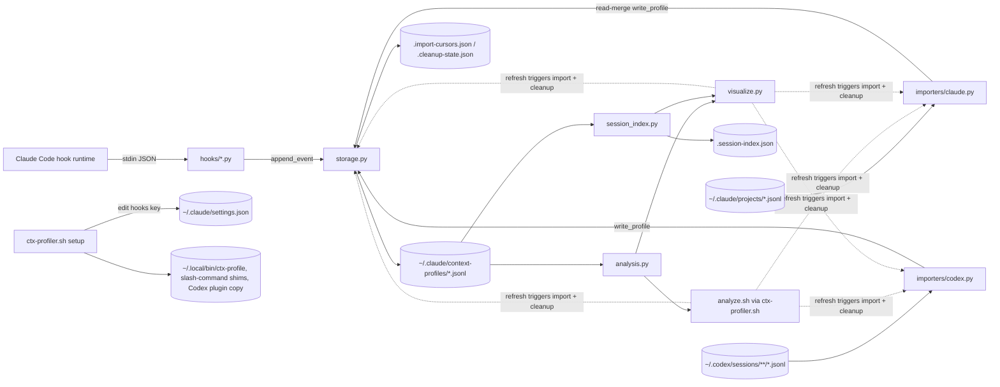

# context-profiler — Architecture

Current-state capture of the repository at `9771c5b` ("Build context profiler").
Portable build/run/test inputs live in [`runtime-setup.md`](runtime-setup.md);
deployment and observability posture lives in [`infra.md`](infra.md); repo
vocabulary lives in [`domain-language.md`](domain-language.md).

## Service Summary

| Field | Value |
|---|---|
| Description | Local, single-user observability tool for Claude Code and Codex agent sessions. Captures Claude hook events and imports Claude/Codex transcripts into a shared normalized JSONL profile store, then renders a Textual terminal dashboard and compact CLI summaries of context growth, spikes, tools, agents, skills, files, turns, compactions, and advice. |
| Classification | Local developer tool / agent-harness plugin (CLI + hooks + TUI). Not a network service, not a library published to a registry. |
| Users / callers | Humans in a split terminal (`ctx-profile watch`); agents via the `/context-profiler` slash command and compact CLI output (`explain`, `files`, `turns`, `latest`); the Claude Code hook runtime (hook scripts). |
| Primary capabilities | Live hook capture, incremental transcript import, profile storage with rotation and retention cleanup, session indexing with parent/child relationships, stats/turn/forensics/advice analysis, TUI dashboard, setup/installer. |
| Dependencies | Python 3 standard library; `textual` (only for the dashboard); `git` CLI (branch lookup, optional); bash. |
| Data stores | Local filesystem only: `$HOME/.claude/context-profiles/*.jsonl` (+ `.part-NNNN.jsonl`), `config.json`, `.session-index.json`, `.import-cursors.json`, `.cleanup-state.json`; `/tmp/ctx-profiler-start/<session>/` duration stamps. Reads `$HOME/.claude/projects/**/*.jsonl` and `$HOME/.codex/sessions/**/*.jsonl`. |
| Run / test | `bash ./ctx-profiler.sh setup`, `ctx-profile <cmd>`; `python3 -m unittest discover -s tests -v` (see `runtime-setup.md`). |
| Confidence | High for module boundaries, storage, import, and CLI flows (source read directly); medium for `visualize.py` internals (1311 lines, inspected by symbol/imports and tests, not line-by-line). |

## What This Repo Owns

- The normalized profile event schema (`session_start`, `turn_start`, `context_snapshot`, `tool_call`, `compaction`, `session_end`) and its JSONL persistence (`context_profiler/storage.py`).
- Source adapters converting Claude hook payloads / Claude transcripts / Codex rollout transcripts into that schema (`hooks/*.py`, `context_profiler/importers/*.py`).
- Derived analysis: stats, turns, compaction forensics, agent runs, advice (`context_profiler/analysis.py`).
- The `ctx-profile` CLI, `/context-profiler` slash-command template, plugin manifests, installer, and Textual dashboard.

It does **not** own Claude/Codex transcripts (read-only inputs, deletable only by explicit `--include-codex-transcripts`) or the Claude Code settings schema (it edits the `hooks` key of `$HOME/.claude/settings.json` during setup).

## Main Capabilities

1. Live capture of Claude tool calls, compactions, session start/end through Claude Code hooks (async, failure-swallowing).
2. Incremental import of Codex rollout transcripts and Claude parent transcripts (agent lifecycle), gated by file-signature cursors.
3. Profile rotation (`profile_max_part_bytes`, default 10 MB) and retention cleanup (default 5 days, throttled every 24 h).
4. Session index with parent/child role labels.
5. Analysis and heuristic advice with ignore-path filtering so the profiler does not report on itself.
6. Human dashboard (TTY-only) and agent-safe compact CLI output.

## Module / Package Inventory

Module assessment: **single runtime with several important internal areas**
(one Python package + scripts, one install path, one test suite). There is no
independent build/deploy unit and no nested `CLAUDE.md` / `AGENTS.md` (only the
root `AGENTS.md`). Root context alone would flatten distinct writer/state rules
(hooks append vs importers rewrite vs cleanup delete), so semantic boundaries
get focused module detail docs.

| Area | Path | Purpose | Entry | Notes |
|---|---|---|---|---|
| Capture & import adapters | `hooks/`, `context_profiler/importers/` | Source-specific normalization into profile events | Claude hook runtime (stdin JSON); import functions called on CLI/TUI refresh; `codex-profiler.py` | Writers of profile state |
| Profile storage & session index | `context_profiler/storage.py`, `context_profiler/session_index.py`, `context_profiler/config.py` | Source of truth for profiles, cursors, config, cleanup, index cache | Library calls | Owns all on-disk state |
| Analysis | `context_profiler/analysis.py`, `context_profiler/formatting.py` | Pure read-model derivation and advice | Library calls | Stateless except `load_config` for ignore patterns |
| CLI, setup & plugin packaging | `ctx-profiler.sh`, `analyze.sh`, `codex-profiler.py`, `commands/`, `.claude-plugin/`, `.codex-plugin/`, `context_profiler_core.py` | Command surface, installer, compatibility facade | `ctx-profile`, `/context-profiler` | Setup mutates host config |
| Dashboard | `visualize.py` | Textual TUI | `ctx-profile watch` → `visualize.py` | Only module needing `textual`; TTY-only |
| Tests | `tests/` | unittest suite | `python3 -m unittest discover -s tests` | Patches `PROFILE_DIR` to temp dirs |

## Module Detail Coverage

| Module / boundary | Detail doc / gap | Reason |
|---|---|---|
| Capture & import adapters | `docs/prinevo-docs/modules/capture-and-import.md` | Distinct entrypoints (hook runtime vs refresh-driven import), two writer styles, source-specific lifecycle rules |
| Profile storage & session index | `docs/prinevo-docs/modules/profile-storage.md` | Owns all durable state, rotation, cursors, cleanup/deletion safety |
| Analysis | `docs/prinevo-docs/modules/analysis.md` | Read-model owner shared by CLI and TUI; advice heuristics |
| CLI, setup & plugin packaging | `docs/prinevo-docs/modules/cli-and-setup.md` | Host-config mutation during setup; agent-facing command contract |
| Dashboard | `docs/prinevo-docs/modules/dashboard.md` | Distinct dependency (`textual`), TTY guard, refresh loop that also triggers import/cleanup |

## Architecture Overview

Style: **pipes-and-filters over a local file store**. Source adapters write
normalized events into per-session JSONL profiles; consumers (CLI, TUI) read
profiles, derive stats on demand through a shared analysis module, and render.
There is no daemon: imports and cleanup run opportunistically each time the
CLI or dashboard refreshes. `context_profiler_core.py` is a compatibility
facade re-exporting the package API to hooks and shell scripts.

## Layer / Boundary Model

```text
Adapters (source-specific)      hooks/*.py, importers/claude.py, importers/codex.py
        │ write normalized events
Storage (state owner)           storage.py (+ config.py, session_index.py cache)
        │ load events
Analysis (pure derivation)      analysis.py, formatting.py
        │ stats / turns / advice
Presentation                    analyze.sh (CLI text), visualize.py (Textual TUI)
Packaging / install             ctx-profiler.sh setup, commands/, plugin manifests
```

Rules visible in `AGENTS.md` and code: source-specific behavior stays in
adapters; shared storage/analysis is source-neutral; Textual stays in
`visualize.py`; new harnesses implement `ProfileImporter`
(`context_profiler/importers/base.py`) and add to `sources` config.

## Component Diagram



## Entry Points

| Entry | Trigger | File |
|---|---|---|
| `ctx-profile <cmd>` / `ctx-profiler` | Shell (installed shim) | `ctx-profiler.sh` → `analyze.sh` / `visualize.py` / `codex-profiler.py` |
| `/context-profiler ...` | Claude/Codex slash command | `commands/context-profiler.md` (rendered with source path at setup) |
| SessionStart / PreToolUse / PostToolUse / PreCompact / Stop hooks | Claude Code hook runtime, async | `hooks/session-start.py`, `pre-tool-use.py`, `post-tool-use.py`, `pre-compact.py`, `session-end.py` |
| `codex-profiler.py [--watch|--once|--latest|--session-file]` | Shell | `codex-profiler.py` |
| Python API | Import | `context_profiler_core.py` (facade), `context_profiler/*` |

## Internal Structure

See module docs. Key internal contracts: `ProfileImporter` protocol
(`importers/base.py`), event dicts with `type`/`ts`/`source`/`session_id`/`meta`,
`IMPORT_CURSOR_VERSION = 2` (`storage.py`), session index `version: 1`.

## Runtime / Request Flows

**F1 — Live Claude tool call (state-changing)**
```text
Claude tool use -> PreToolUse hook stamps /tmp/ctx-profiler-start/<sid>/<tool>-<ms>
-> PostToolUse hook (stdin payload) -> normalize_claude_tool_event (importers/claude.py)
-> append_event (storage.py; rotates to .part-NNNN when > profile_max_part_bytes)
-> <sid>.jsonl -> verified by tests/test_claude_importer.py, tests/test_storage.py
```
All hooks exit silently on any exception and when `enabled` is false.

**F2 — Codex transcript import (state-changing, refresh-driven)**
```text
CLI/TUI refresh -> import_latest_codex_profiles (limit codex_import_limit=25)
-> transcript_import_current? skip : import_codex_transcript (full reparse)
-> write_profile (atomic tmp+replace per part, prunes stale parts) -> codex-<sid>.jsonl
-> mark_transcript_imported (.import-cursors.json) -> tests/test_codex_importer.py
```

**F3 — Claude agent lifecycle import (state-changing, merge)**
```text
refresh -> import_latest_claude_profiles (excludes */subagents/*)
-> import_claude_transcript: extract Agent tool_use rows + side transcripts
-> load existing hook profile -> merge by raw_tool_use_id / description
-> write_profile (rewrite whole profile) -> <sid>.jsonl
```

**F4 — Agent-facing summary (read-only)**
```text
ctx-profile explain|files|turns|latest [--source] [--session]
-> analyze.sh: run_auto_cleanup + imports (side effects) -> load_events
-> compute_stats / build_turns / build_recommendations -> compact text on stdout
```
Read path is not side-effect free: every CLI read may import and delete old profiles.

**F5 — Dashboard (read-only view, side-effecting refresh)**
```text
ctx-profile watch (TTY check in ctx-profiler.sh and analyze.sh) -> visualize.py
-> set_interval(refresh_interval_seconds) -> run_auto_cleanup + imports
-> refresh_session_index -> compute_stats for active session -> render active tab
```

**F6 — Setup (host-config mutation)**
```text
ctx-profiler.sh setup -> ensure_config -> optional pip install --user textual
-> rewrite $HOME/.claude/settings.json hooks (dedupe old context-profiler entries)
-> render slash-command shims (Claude + Codex) -> copy Codex plugin -> $HOME/.local/bin shims
```

## Read / Write Boundary

| State | Writer | Readers | Notes |
|---|---|---|---|
| Profile JSONL (+parts) | `storage.append_event` (hooks), `storage.write_profile` (importers) | analysis, session index, CLI, TUI | Source of truth for profiler data; transcripts are upstream inputs |
| `.import-cursors.json` | `storage.mark_transcript_imported` | importers | Rebuildable cache keyed by transcript path + size/mtime signature |
| `.session-index.json` | `session_index.refresh_session_index` | TUI Sessions tab | Rebuildable projection; invalidated per profile signature and spike threshold |
| `config.json` | `config.save_config` / `ensure_config` (setup, enable/disable, status) | everything | Defaults merged on every load; default ignore patterns re-added |
| `.cleanup-state.json` | `storage.run_auto_cleanup` | same | Throttle marker |
| `/tmp/ctx-profiler-start/` | pre-tool-use hook; consumed by post-tool-use | post hook | Files >60 s pruned |
| `$HOME/.claude/settings.json` hooks | `ctx-profiler.sh setup` | Claude Code | External config, edited in place |

Forbidden shortcuts (from `AGENTS.md`): do not stream profiles/transcripts into
agent responses; do not delete raw transcripts without explicit flag; do not
hard-code user paths. No authn/authz or tenancy: single local user, file
permissions only. Failure behavior: malformed JSON lines are skipped; hook
errors are swallowed; missing transcripts dirs yield empty imports.

## Multi-Client / Adapter Boundary

Shared read-model owner: `context_profiler/analysis.py` (`compute_stats`,
`build_turns`, `build_forensics`, `build_agent_runs`, `build_recommendations`).
Clients: CLI text (`analyze.sh` inline Python), Textual TUI (`visualize.py`),
slash command (wraps CLI). Risk: `analyze.sh` redefines its own `fmt_bytes` /
`fmt_tokens` and per-command aggregation inline instead of reusing
`formatting.py`; `visualize.py` also assembles some per-tab aggregation. Planned
JSON/MCP agent contract (README "Consumption Model") is not implemented.

## Dependency Direction And Coupling

- Direction is clean in the package: `importers -> storage -> config`, `analysis -> config/formatting`, `session_index -> analysis/storage`. Analysis never imports storage writers.
- Hooks and shell scripts depend on the facade `context_profiler_core.py`, not the package modules; the facade must keep re-exports stable (it is a public contract for installed hooks).
- `analyze.sh` embeds ~390 lines of Python in a heredoc and interpolates `$PLUGIN_DIR` into `python3 -c` strings (enable/disable/status).
- Paths are module-global constants computed at import (`config.PROFILE_DIR`); tests patch them per module (`context_profiler.storage.PROFILE_DIR`, `context_profiler.session_index.PROFILE_DIR`), showing duplicated global state rather than injected paths.
- `codex_sessions_dir` / `claude_projects_dir` are configurable, but `PROFILE_DIR` is not (fixed to `$HOME/.claude/context-profiles`) and `ctx-profiler.sh` hardcodes it again.

## Runtime Dependencies

Python 3 stdlib; `textual` (dashboard only); `git` (optional, branch label);
bash; filesystem access to `$HOME/.claude`, `$HOME/.codex`, `$HOME/.local/bin`, `/tmp`.
No network calls, no database, no queue.

## API Contracts

| Contract | Dir | Actor | Shape | Auth | Evidence | Confidence |
|---|---|---|---|---|---|---|
| `ctx-profile` CLI | exposes | human, agent | subcommands `setup, watch, status, enable, disable, latest, summary, session, top, files, turns, explain, clean, codex-import, doctor`; flags `--source`, `--session`, `--include-ignored`, `--days`, `--dry-run`, `--include-codex-transcripts`, `--all-sessions` | local user | `ctx-profiler.sh`, `analyze.sh` | code-defined, high |
| `/context-profiler` slash command | exposes | Claude / Codex agent | `$ARGUMENTS` forwarded to `ctx-profile` | local user | `commands/context-profiler.md` | code-defined |
| Claude hook payloads | consumes | Claude Code | stdin JSON: `session_id`, `tool_name`, `tool_input`, `tool_response`/`tool_result`, `transcript_path`, `cwd` | none (local process) | `hooks/*.py`, `importers/claude.py` | code-defined |
| Claude transcript JSONL | consumes | Claude Code files | rows with `sessionId`, `timestamp`, `message.content[].tool_use(name=Agent)`, side transcripts `<stem>/subagents/*.jsonl` | file perms | `importers/claude.py` | code-defined, upstream format not versioned |
| Codex rollout JSONL | consumes | Codex files | rows `type` in `session_meta`, `event_msg(task_started, token_count, ...)`, `response_item` function calls (`spawn_agent`, `wait_agent`, shell) | file perms | `importers/codex.py` | code-defined, upstream format not versioned |
| Profile event JSONL | exposes (to new importers / other tools) | importers, analysis | see Data Models | file perms | `storage.py`, README "To add another harness" | code-defined |
| Python facade | exposes | hooks, scripts | `context_profiler_core.__all__` | n/a | `context_profiler_core.py` | code-defined |
| Plugin manifests | exposes | Claude / Codex plugin loaders | `.claude-plugin/plugin.json`, `.codex-plugin/plugin.json` v0.1.0 | n/a | manifests | code-defined |

Public API Auth: no internet-reachable surface exists; not applicable.
Agent JSON/MCP contract: **API contract gap** — documented as future in README, not implemented.

## Data Models And Schemas

### Domain / Application Models

Event `type` values: `session_start` (`cwd`, `git_branch`, `meta.transcript_path`),
`turn_start` (`turn_id`, `model_context_window`), `context_snapshot` (Codex token
counts), `tool_call` (`tool`, `input_bytes`, `output_bytes`, `est_tokens`,
`duration_ms`, `cumulative_transcript_bytes`, `meta.{file_path, command,
subagent_type, description, skill_name, parent_session_id, child_session_id,
child_session_ids, raw_tool_use_id, status, ...}`), `compaction`
(`compaction_index`, `transcript_bytes_before`, `est_tokens_before`),
`session_end` (totals). Derived: turn, agent run, spike, forensics entry,
recommendation (`severity`, `title`, `detail`, `action`). Sources:
`hooks/*.py`, `importers/*.py`, `analysis.py`.

### Persistence Schemas

JSONL, one event per line; file naming `<sid>.jsonl` (Claude/custom) and
`codex-<sid>.jsonl`; parts `<stem>.part-NNNN.jsonl`. Cursors file:
`{source: {transcript_path: {cursor_version, signature{size,mtime_ns}, profile, status, imported_at}}}`.
Index: `{version: 1, updated_at, sessions: {path: summary}}`. Config keys: see `runtime-setup.md`.

### API / DTO Schemas

CLI text output only; no JSON output mode. Not applicable beyond CLI contract.

### Event Schemas

Profile events above are the only event schema; no bus/queue.

### Migrations / Schema Evolution

No migration mechanism. `IMPORT_CURSOR_VERSION` bump forces reimport;
`_merge_config` back-fills new config defaults. Profile event schema is unversioned.

## Events / Queues / Background Work

No queues. Background-like work: Claude hooks run `async: true`; imports and
auto-cleanup run inline on each CLI command and on every dashboard refresh
interval (default 2 s; cleanup throttled to 24 h).

## Data / Storage Ownership

All state is local to one user's home directory; see Read / Write Boundary.
Profiles may contain command text, prompt previews (300 chars), file paths, and
output previews from observed sessions — sensitive by nature, kept local.

## Architecture Risks / Hotspots

| Risk | Evidence | Impact | Confidence |
|---|---|---|---|
| Lost-update race between hook `append_event` and Claude importer read-merge-`write_profile` on the same `<sid>.jsonl` (no locking) | `storage.py` `append_event` vs `write_profile`; `importers/claude.py` `import_claude_transcript` | Hook events appended during a merge rewrite can be dropped | medium (candidate risk) |
| Read commands have side effects (import + delete) | `analyze.sh` top-level `run_auto_cleanup` and imports; `visualize.py` refresh | Running `ctx-profile latest` can delete profiles older than retention | high |
| Large monolithic files | `visualize.py` 1311 lines; `analyze.sh` with ~390-line Python heredoc | Harder change isolation; CLI logic untested | high |
| Duplicated formatting/path constants | `analyze.sh` `fmt_tokens`/`fmt_bytes`; `PROFILE_DIR` in `config.py`, `ctx-profiler.sh`, `analyze.sh` | Drift between CLI and TUI output | high |
| Unversioned upstream transcript formats | `importers/codex.py`, `importers/claude.py` | Upstream Claude/Codex changes silently drop data | medium |
| Approximate tokens for Claude (`bytes // 4`) | `formatting.estimate_tokens`, `pre-compact.py` | Advice is directional only (documented) | high |
| Codex importer reparses whole transcript on change | `import_codex_transcript` reads all lines | Cost grows with long sessions | medium |
| Setup edits `$HOME/.claude/settings.json` and falls back to `{}` on parse error | `ctx-profiler.sh install_claude_hooks` | A malformed settings file would be overwritten with only hooks | medium |
| Hook duration pairing by tool name + latest stamp | `post-tool-use.py` | Concurrent same-tool calls get wrong durations | medium |

## Refactor Candidates

Candidates only, not approved work:
- Move `analyze.sh` inline Python into a `context_profiler/cli.py` module so it is testable and reuses `formatting.py`.
- Add a file lock or append-only merge for Claude importer writes.
- Separate read-only CLI commands from import/cleanup side effects (or add `--no-cleanup`).
- Implement the documented `--json` agent contract on top of `analysis.py`.
- Make `PROFILE_DIR` configurable via env var to remove per-module test patching.

## Run And Test

See [`runtime-setup.md`](runtime-setup.md). Test suite: 17 unittest tests; in
this scan 16 ran green and `tests/test_visualize_sessions.py` failed to import
because `textual` was not installed on the scan host.

## References

| Evidence | Path |
|---|---|
| README, agent rules | `README.md`, `AGENTS.md` |
| CLI / setup | `ctx-profiler.sh`, `analyze.sh`, `codex-profiler.py`, `commands/context-profiler.md` |
| Plugin manifests | `.claude-plugin/plugin.json`, `.codex-plugin/plugin.json` |
| Package | `context_profiler/{config,storage,session_index,analysis,formatting}.py`, `context_profiler/importers/{base,claude,codex}.py`, `context_profiler_core.py` |
| Hooks | `hooks/*.py` |
| Dashboard | `visualize.py` |
| Tests | `tests/test_*.py` |
| CI / IaC | none present |

## Evidence / Confidence

| Dimension | Status |
|---|---|
| Scope | Whole repo, commit `9771c5b`; high confidence |
| Entry | CLI, slash command, hooks, Python facade — captured |
| Contract | CLI, hook payloads, transcript inputs, profile JSONL — code-defined; JSON agent contract is an API contract gap |
| State | Local files only — captured |
| Writer | append_event / write_profile / save_config / cleanup — captured |
| Flow | F1–F6 captured |
| Verification | unittest suite; no CI; CLI (`analyze.sh`) and hooks lack direct tests — LLD capture gap for CLI tests |
| Operation | Local install only; see `infra.md` |
| Evolution | Risks and refactor candidates above; `visualize.py` medium-confidence (Architecture Depth Gap: not read line-by-line) |

## Agent Work Log

- Inputs checked: README, AGENTS.md, manifests, all Python modules and shell scripts (visualize.py by symbols/imports), tests; ran unit tests in an isolated temporary HOME.
- Decisions: artifact choice `update` (no prior docs existed, created fresh); single-runtime repo with five semantic module docs.
- Gaps: JSON/MCP agent API contract gap; no CI; `visualize.py` partial depth; CLI untested.
- Next action: setup-agent may use the module inventory; Bring-up should verify the `textual` install path.
